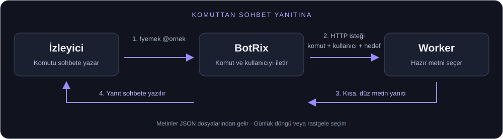

# BotRix Chat Commands

**Blush kanalında kullandığımız sohbet komutlarını kendi kanalına kur:**
BotRix mesajı alır, Cloudflare Worker yanıtı hazırlar, BotRix yanıtı sohbete yazar.
Bu depo çalışan yöntemin taşınabilir kaynak kodunu, hazır metinlerini ve ayrıntılı
kurulum rehberini içerir.

**12 burç + 9 sohbet komutu · 1.510 hazır yanıt · Türkçe · JavaScript**

## Nasıl çalışıyor?



Worker metinleri `data/` dosyalarından seçer. Her çağrıda AI üretimi, başka bir
siteden yorum çekme veya kullanıcı veritabanı işlemi yapmaz. Kick geliştirici
uygulaması ya da API anahtarı kurmak gerekmez. Barındırma için kendi Cloudflare
hesabını, sohbet bağlantısı için kendi BotRix kurulumunu kullanırsın.

## Komutlar

| Komut | Sonuç | Seçim |
| --- | --- | --- |
| `!koç` … `!balık` | 12 burca 30 günlük yorum paketi | Burç başına günlük sabit |
| `!gergin` | Yayıncı için yüzde ve espri | Her çağrıda rastgele |
| `!andaval` | Seçilen kişiye yüzde ve espri | Her çağrıda rastgele |
| `!aşk` | Kişiye flört modu veya ikiliye aşk yüzdesi | Kişi/ikili başına günlük sabit |
| `!çiçek` | Çiçek ve kısa kişilik benzetmesi | Kişi başına günlük sabit |
| `!enayi` | Yüzde ve iyi niyet esprisi | Her çağrıda rastgele |
| `!ilişki` | Sekiz kısa ilişki durumundan biri | Kişi başına günlük sabit |
| `!yancı` | 240 kafe siparişinden biri | Kişi başına günlük sabit |
| `!bok` | Yüzde ve argo espri | Her çağrıda rastgele |
| `!yemek` | 10 gruptan 200 farklı menü | Her çağrıda rastgele |

Yüzdeler, burç yorumları ve kişilik/ilişki sonuçları **sohbet oyunu** niteliğindedir.
Argo komutları kanalında kullanmak istemiyorsan BotRix'e ekleme.
Günlük sonuçlar İstanbul saatine göre **00.01'de** değişir.
[Tüm komutlar ve davranışları →](docs/COMMANDS.md)

## Hızlı başlangıç

[Node.js 22 veya üzeri](https://nodejs.org/en/download) ve Git kurulu olmalı.
CI kontrolleri Node.js 24 kullanır.

```powershell
git clone https://github.com/tinitavolkan/botrix-chat-commands.git
cd botrix-chat-commands
npm ci
npm test
npm run dev
```

Terminalde gösterilen yerel adreste dene:

```text
http://localhost:8787/?komut=yemek&kullanici=ornek
http://localhost:8787/?komut=ask&kullanici=ornek&hedef=arkadas
http://localhost:8787/?burc=aslan
```

Yayıncı adı ve kafe başlığı `settings.json` içinden değişir.
Cloudflare'da yayınlamadan önce `wrangler.jsonc` içindeki `name` alanına kendi
Worker adını ver. Ardından:

```powershell
npx wrangler login
npm run deploy
```

Dağıtım kendi Cloudflare hesabında bir Worker oluşturur veya aynı isimli Worker'ı
günceller. Terminalde verilen **kendi adresini** kullanarak BotRix satırlarını üret:

```powershell
npm run commands -- https://KENDI-WORKER-ADRESIN.workers.dev
```

Çıktıdaki `!addcom ...` satırlarından istediklerini, komut yönetme yetkin olan
kanalda tek tek uygula. Mevcut komutları değiştirmek için aynı komuta `--edit` ekle.

**[Adım adım Cloudflare + BotRix kurulumu →](docs/SETUP.md)**

## Yöntemi öğrenmek için

- [Yöntem ve mimari](docs/METHOD.md): hazır metin yaklaşımı, günlük döngü, rastgele
  seçim, kişi etiketleme ve geçmişteki hataların nedeni.
- [Kurulum](docs/SETUP.md): yerel deneme, Worker yayını, BotRix bağlantısı ve sorun giderme.
- [Komut sözlüğü](docs/COMMANDS.md): tüm rotalar, parametreler, örnek kullanımlar ve HTTP durumları.
- [Özelleştirme](docs/CUSTOMIZATION.md): isimleri ve metinleri değiştirme, döngüleri koruma ve güncelleme.

## Dosya düzeni

```text
src/index.js              Cloudflare giriş dosyası
src/worker.js             İstekleri karşılayan ve test edilebilen JavaScript
data/*.json              Burç, yüzde, aşk, çiçek, ilişki, kafe ve menü metinleri
settings.json            Yayıncı/kafe adı ve burç başlangıç tarihi
wrangler.jsonc           Cloudflare giriş dosyası ve Worker adı
scripts/commands.js      Kendi adresinle 21 BotRix satırı üretir
tests/                   Tarih, kişi seçimi, döngü ve komut testleri
docs/                    Ayrıntılı yöntem ve kurulum belgeleri
```

`npm test` yerel davranış testlerini, `npm run build` dağıtım yapmadan Worker
derlemesini çalıştırır. GitHub Actions Windows ve Ubuntu'da test ve derleme yapar;
Cloudflare'a otomatik yayın yapmaz. Bağımlılıklar `package-lock.json` ile sabitlenir.

## Yayın ve gizlilik

Bu depoda sohbet geçmişi, izleyici listesi, Cloudflare hesap kimliği, kişisel
Worker adresi, giriş bilgisi veya eski dağıtım kayıtları yoktur. Hazır içerik
paketleri ve genel kanal adları vardır. Uygulama kullanıcı adlarını yanıtta
göstermek için işler; bunları depolamaz. Hizmet sağlayıcıların kendi istek
işleme politikaları ayrıca geçerlidir. [Veri akışı ve güvenlik →](SECURITY.md)

Kaynak kod ve içerik paketleri MIT lisansıyla paylaşılır. Bağımsız bir topluluk
projesidir; BotRix, Kick veya Cloudflare'ın resmî ürünü değildir.

### English

Portable Turkish chat commands using BotRix custom-command fetch and a Cloudflare
Worker. Includes 12 horoscope commands, 9 chat commands, 1,510 prepared responses,
deterministic daily cycles, random selections, username handling, tests and a
detailed Turkish deployment guide. Bring your own Worker URL; no personal account
configuration or chat logs are included.
